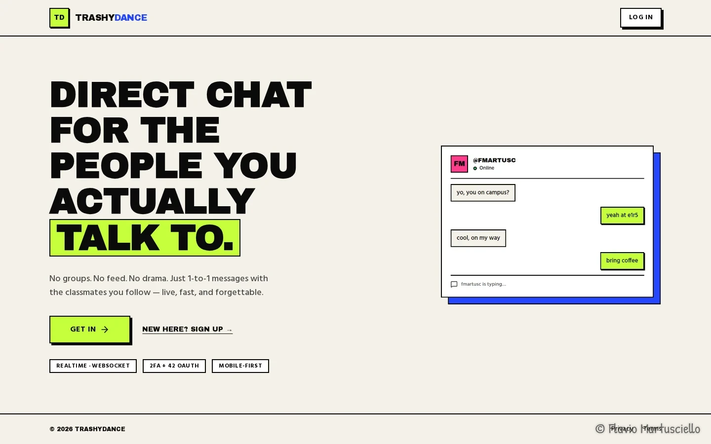
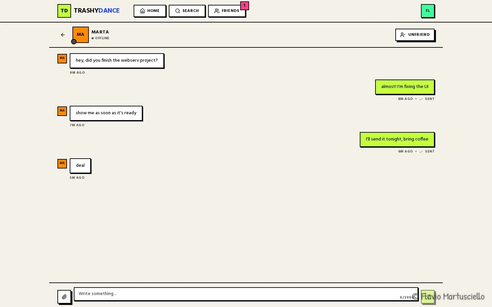
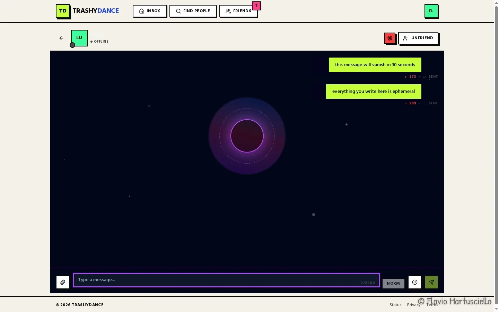

# trashydance

A real-time 1-to-1 chat with a neobrutalist look. It's the final project of the 42 Common Core (ft_transcendence), built in a team of four at 42 Roma Luiss.



This is a copy of the team repository, kept on my profile as part of my portfolio. The full commit history is in the original repo: [trashydance/trashydance](https://github.com/trashydance/trashydance).

## What it does

You sign up with email or with your 42 account, add friends, and chat with them in real time. You can send files, search people and old messages, turn on two-factor authentication and switch between English, Italian and Bulgarian. Online status, unread counts and read receipts update live.

There are also a couple of small surprises: click the TD logo and the coin flips in 3D, and in Black Hole mode messages disappear after 30 seconds.

| | |
|---|---|
|  |  |

## My part

I was the product owner and designer of the team.

- the neobrutalist visual identity and the UI/UX of the whole app
- the component library, built from scratch with Tailwind (19+ components in `components/ui/`)
- the landing page and the global layout
- the Privacy Policy and Terms of Service pages
- the product backlog and feature priorities

## Team

- fmartusc ([Fmartu](https://github.com/Fmartu)): product owner, design, front-end
- edforte ([edforte](https://github.com/edforte)): tech lead, authentication, 2FA, database, Docker and CI
- vzashev ([99shandhokhan88](https://github.com/99shandhokhan88)): tech lead, Socket.IO, chat, file uploads, presence
- lrocca ([leeoocca](https://github.com/leeoocca)): project manager, friends, search, notifications, profiles

## Stack

Next.js 16 and React 19, Socket.IO, SQLite with Drizzle ORM, better-auth (42 OAuth and TOTP), Tailwind CSS, Docker with Caddy for HTTPS.

## Run it

With Docker:

```bash
bash certs/generate.sh      # self-signed certificate for localhost
cp .env.example .env        # then fill in BETTER_AUTH_SECRET and the 42 OAuth keys
docker compose up
```

Then open https://localhost:8443 and accept the certificate warning.

For development, with Node 22+ and pnpm:

```bash
pnpm install
cp .env.example .env        # set BETTER_AUTH_URL=http://localhost:3000
pnpm db:migrate
pnpm dev
```

To log in with 42 you need an OAuth app on the 42 Intra, with the callback `https://localhost:8443/api/auth/oauth2/callback/42`.
